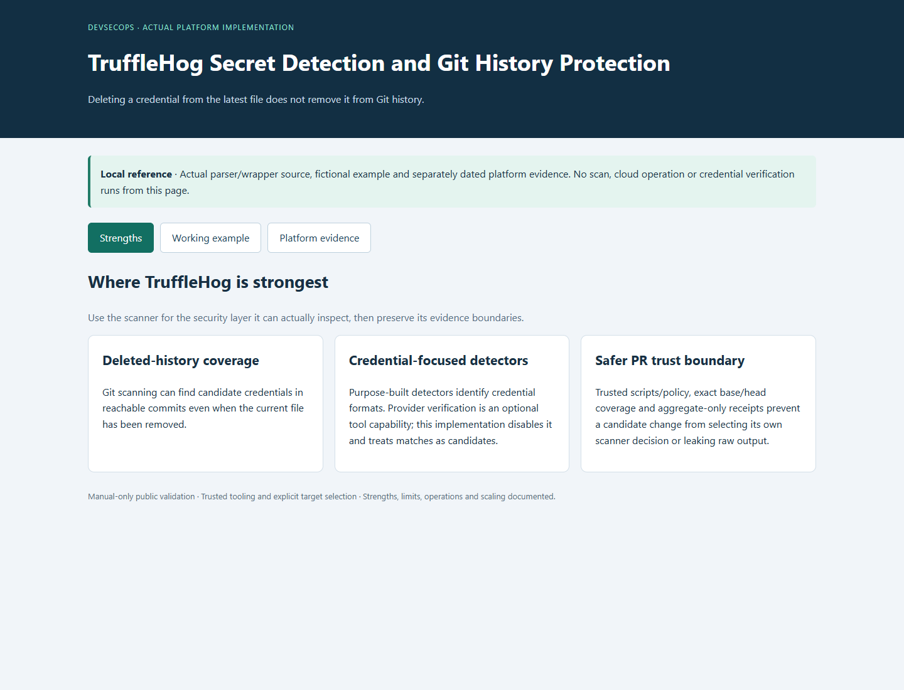
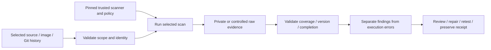
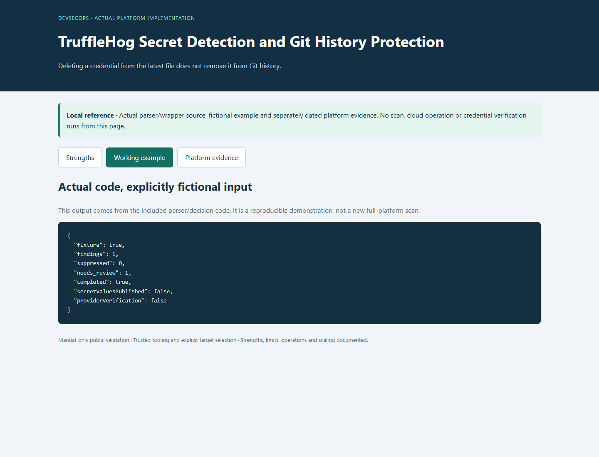

# TruffleHog Secret Detection and Git History Protection

**Find possible leaked credentials, including ones deleted from the latest files.**

[Business problem](#the-business-problem) · [Strengths](#where-trufflehog-is-strong) · [Proof](#proof-it-works) · [Commands](docs/COMMANDS.md)



## The Business Problem

Passwords, keys or tokens can remain in Git history after a file is edited or deleted. A secret scanner’s own output may also reveal the value it found. Proposed code changes must not be allowed to choose their own scanning rules.

## The Solution

Use a fixed version of TruffleHog to inspect the selected Git history or proposed change. Run trusted scanning code with read-only access and no network inside the scanning container. Check that coverage is complete and publish counts rather than possible secret values.

**Business outcome:** The process checks deleted history and keeps possible secrets private. A recorded review confirmed that three candidates were public package hashes, without adding broad rules that hide future findings.

## Where TruffleHog Is Strong

| Strength | Practical value |
| --- | --- |
| **Deleted-history coverage** | Search earlier Git versions for possible credentials, even after a file is deleted. |
| **Credential-focused detectors** | Look for patterns used by passwords, keys and tokens. The tool can optionally check whether a credential works; this setup disables that step and reviews matches privately. |
| **Safer PR trust boundary** | Use scanning code from the trusted base version, check the exact proposed change and publish counts only. The proposed code cannot choose its own rules or expose possible secret values. |

This tool covers one part of security. The other scanners check different areas, so the results need to be considered together. [Strengths, limits and tradeoffs](docs/STRENGTHS-AND-TRADEOFFS.md).

## Architecture



Each scanner checks a different kind of information and needs suitable protection for its reports. TruffleHog 3.99.4 is the selected source pin, not a claim that it is the latest release. [Actual source map](docs/SOURCE-MAP.md).

## What Was Built

| Component | Purpose | Implementation |
| --- | --- | --- |
| Scan script | Check the intended files with trusted tools and protect the report | [Source](scripts/trufflehog_scan.py) |
| Existing behavior tests | Reject missing or unreadable reports and checks of the wrong files | [Tests](scripts/) |
| Fixed scanner version and settings | Record the tool version and the rules used | [Configuration](security/) |
| Real pipeline example | Show how the real pipeline runs checks, without running it here | [Inert workflow](reference/workflows/trufflehog-pr.yml.example) |
| Platform findings | Preserve dated fixes and remaining work | [Recorded findings](data/platform-findings.json) |
| Offline example/viewer | Exercise actual parsing/decision code with fictional inputs | [Example](scripts/demo.py) |

## Proof It Works

### 1. Test the actual boundary code

```bash
python -B -m unittest discover -s scripts -p 'test_*.py' -v
python -B scripts/demo.py
```

**Look for:** 21 passing original contract cases; two optional integration cases are separately recorded. The demonstration using test data is labeled and does not pretend to be a current full-platform scan. [Dated validation](docs/VALIDATION.md) records exact executed/skipped cases.

### 2. Inspect genuine scanner evidence separately

The parser demonstration accepts a fictional candidate and emits only counts. A separate real scanner test uses a disposable repository and an unregistered generated key that is committed and deleted; its exact observed outcome is recorded in Validation. No test key or raw scanner output is published.



Local scans cover only this public reference. Dated platform reports are retained as history; local test-example output does not replace or clear the full platform finding register. No cloud credentials, resource changes or provider credential verification are needed.

### 3. Follow findings through to a defensible decision

Keep the target, version, database/policy context and completion evidence. Review the actual finding, apply a compatible fix where justified, repeat the relevant checks and preserve unresolved items. A scanner timeout, incorrectly structured report or missing inventory cannot become a successful scan with zero findings.

### Privacy and history coverage

The actual implementation rejects incomplete/shallow/rewritten history, unsupported local Git configuration, a moved head and mismatched completion records. PR mode binds base, head and merge base. Raw candidate output and diagnostic files remain private and bounded; the safe parser excludes Raw, Redacted and ExtraData values from its aggregate output.

The public wrapper's allowed origin is changed to this project; it must not be broadened to arbitrary repositories as an unexplained convenience. Exact, expiring suppressions are separate from global scanner ignores. If a real credential is exposed, revoke/rotate it and review usage; removing a file or rewriting history alone does not revoke it.


## Run the Local Viewer

```bash
python -B scripts/preview.py --port 8138
```

Open [the local reference](http://127.0.0.1:8138). It shows strengths, actual parser behavior on fictional input and dated platform evidence. It performs no scan, cloud request or sign-in. Ctrl+C stops it. Screenshots are local captures, not a hosted security dashboard.

## Limitations and Tradeoffs

| Boundary | What it means |
| --- | --- |
| A candidate needs review | A match does not prove that a working credential was exposed. Some matches, such as public package hashes, need review before a decision. |
| Scope is explicit | A main-history or PR-range scan is not every branch, ref, artifact, image or external mailbox. |
| Offline means no live validity test | Network none and no-verification reduce exposure, but cannot establish whether a candidate works against a provider. |

The reference workflow is manual-only. Actual platform integration examples are inert files outside .github/workflows. No hosted CI run or deployment was performed to create this project. Do not execute candidate package scripts or expose raw secret candidates while adding security checks.

## Project Guides

| Guide | Purpose |
| --- | --- |
| [Strengths and tradeoffs](docs/STRENGTHS-AND-TRADEOFFS.md) | Why this scanner, where it helps and where it stops |
| [Process and integration](docs/PROCESS.md) | Scope, trust, completion and CI decisions |
| [Findings and fixes](docs/FINDINGS-AND-FIXES.md) | Recorded results versus local examples |
| [Commands](docs/COMMANDS.md) | Commands to repeat the local checks and start the scanner |
| [Operations](docs/OPERATIONS.md) | Handle failures, protect private data and prioritize findings |
| [Scaling](docs/SCALING.md) | Choose what to scan and manage time, cost and access |
| [Source map](docs/SOURCE-MAP.md) | Where the code came from and what changed for this example |
| [Validation](docs/VALIDATION.md) | Local test results and their limits |

Related projects: [Trivy](https://github.com/truthofsource/trivy-vulnerability-management), [TruffleHog](https://github.com/truthofsource/trufflehog-secret-detection), [Checkov](https://github.com/truthofsource/checkov-azure-infrastructure-security), and [delivery/rollback](https://github.com/truthofsource/secure-container-delivery-and-rollback).
