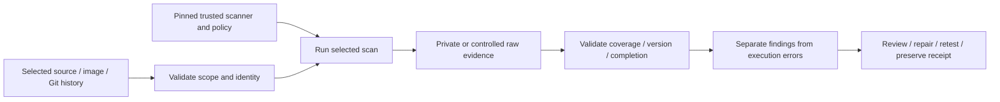

# TruffleHog Secret Detection and Git History Protection

**Deleting a credential from the latest file does not remove it from Git history.**

[Business problem](#the-business-problem) · [Strengths](#where-trufflehog-is-strong) · [Proof](#proof-it-works) · [Commands](docs/COMMANDS.md)


## The Business Problem

A platform repository needed protection against accidentally committed credentials, including values removed in later commits. Scanner output itself could expose candidate secrets, and running PR-supplied tooling or provider verification would create another trust boundary.

## The Solution

Run a digest-pinned scanner against exact complete Git history or a bounded PR range, using trusted-base tooling and a read-only network-disabled scanner container. Validate completion and coverage, then publish only safe aggregate counts.

**Business outcome:** The implementation catches removed history, refuses incomplete coverage and keeps raw candidate fields private. A recorded reconciliation reviewed three detector candidates and confirmed they were public package hashes; it did not create broad secret suppressions.

## Where TruffleHog Is Strong

| Strength | Practical value |
| --- | --- |
| **Deleted-history coverage** | Git scanning can find candidate credentials in reachable commits even when the current file has been removed. |
| **Credential-focused detectors** | Purpose-built detectors identify credential formats. Provider verification is an optional tool capability; this implementation disables it and treats matches as candidates. |
| **Safer PR trust boundary** | Trusted scripts/policy, exact base/head coverage and aggregate-only receipts prevent a candidate change from selecting its own scanner decision or leaking raw output. |

These strengths describe what this tool contributes to the platform's layered checks. It complements the other scanners; it is not a complete application-security assessment. [Strengths, limits and tradeoffs](docs/STRENGTHS-AND-TRADEOFFS.md).

## Architecture



The exact target and output protections differ by scanner. TruffleHog 3.99.4 is the selected source pin, not a claim that it is the latest release. [Actual source map](docs/SOURCE-MAP.md).

## What Was Built

| Component | Purpose | Implementation |
| --- | --- | --- |
| Actual scanner wrapper | Preserve the real target/trust/output boundary | [Source](scripts/trufflehog_scan.py) |
| Original regression tests | Reject incomplete/malformed evidence and unsafe scope assumptions | [Tests](scripts/) |
| Pinned scanner configuration | Make selected tooling and policy explicit | [Configuration](security/) |
| Actual integration reference | Explain the production CI design without activating it here | [Inert workflow](reference/workflows/trufflehog-pr.yml.example) |
| Platform findings | Preserve dated fixes and remaining work | [Recorded findings](data/platform-findings.json) |
| Offline example/viewer | Exercise actual parsing/decision code with fictional inputs | [Example](scripts/demo.py) |

## Proof It Works

### 1. Test the actual boundary code

```bash
python -B -m unittest discover -s scripts -p 'test_*.py' -v
python -B scripts/demo.py
```

**Look for:** 21 passing original contract cases; two optional integration cases are separately recorded. The fixture demonstration is labeled and does not pretend to be a current full-platform scan. [Dated validation](docs/VALIDATION.md) records exact executed/skipped cases.

### 2. Inspect genuine scanner evidence separately

The parser demonstration accepts a fictional candidate and emits only counts. A separate real scanner test uses a disposable repository and an unregistered generated key that is committed and deleted; its exact observed outcome is recorded in Validation. No test key or raw scanner output is published.


Local scans cover only this public reference. Dated platform reports are retained as history; local fixture output does not replace or clear the full platform finding register. No cloud credentials, resource changes or provider credential verification are needed.

### 3. Follow findings through to a defensible decision

Keep the target, version, database/policy context and completion evidence. Review the actual finding, apply a compatible fix where justified, repeat the relevant checks and preserve unresolved items. A scanner timeout, malformed report or missing inventory cannot become a successful scan with zero findings.

### Privacy and history coverage

The actual implementation rejects incomplete/shallow/rewritten history, unsupported local Git configuration, a moved head and mismatched completion records. PR mode binds base, head and merge base. Raw candidate output and diagnostic files remain private and bounded; the safe parser excludes Raw, Redacted and ExtraData values from its aggregate output.

The public wrapper's allowed origin is changed to this project; it must not be broadened to arbitrary repositories as an unexplained convenience. Exact, expiring suppressions are separate from global scanner ignores. If a real credential is exposed, revoke/rotate it and review usage; removing a file or rewriting history alone does not revoke it.


## Run the Local Viewer

```bash
python -B scripts/preview.py --port 8138
```

Open [the local reference](http://127.0.0.1:8138). It shows strengths, actual parser behavior on fictional input and dated platform evidence. It performs no scan, cloud request or sign-in. Ctrl+C stops it. Screenshots are local captures, not a hosted security dashboard.

## Limitations and Tradeoffs

| Boundary | What it means |
| --- | --- |
| A candidate needs review | A detector match is not proof of a live credential; a public package hash can require independent classification. |
| Scope is explicit | A main-history or PR-range scan is not every branch, ref, artifact, image or external mailbox. |
| Offline means no live validity test | Network none and no-verification reduce exposure, but cannot establish whether a candidate works against a provider. |

The reference workflow is manual-only. Actual platform integration examples are inert files outside .github/workflows. No hosted CI run or deployment was performed to create this project. Do not execute candidate package scripts or expose raw secret candidates while adding security checks.

## Project Guides

| Guide | Purpose |
| --- | --- |
| [Strengths and tradeoffs](docs/STRENGTHS-AND-TRADEOFFS.md) | Why this scanner, where it helps and where it stops |
| [Process and integration](docs/PROCESS.md) | Scope, trust, completion and CI decisions |
| [Findings and fixes](docs/FINDINGS-AND-FIXES.md) | Recorded results versus local examples |
| [Commands](docs/COMMANDS.md) | Reproducible local checks and scanner invocation |
| [Operations](docs/OPERATIONS.md) | Failure handling, privacy and triage |
| [Scaling](docs/SCALING.md) | Scope selection, caches, budgets and access |
| [Source map](docs/SOURCE-MAP.md) | Actual source and explicit adaptations |
| [Validation](docs/VALIDATION.md) | Observed local outcomes and limits |

Related projects: [Trivy](https://github.com/truthofsource/trivy-vulnerability-management), [TruffleHog](https://github.com/truthofsource/trufflehog-secret-detection), [Checkov](https://github.com/truthofsource/checkov-azure-infrastructure-security), and [delivery/rollback](https://github.com/truthofsource/secure-container-delivery-and-rollback).
